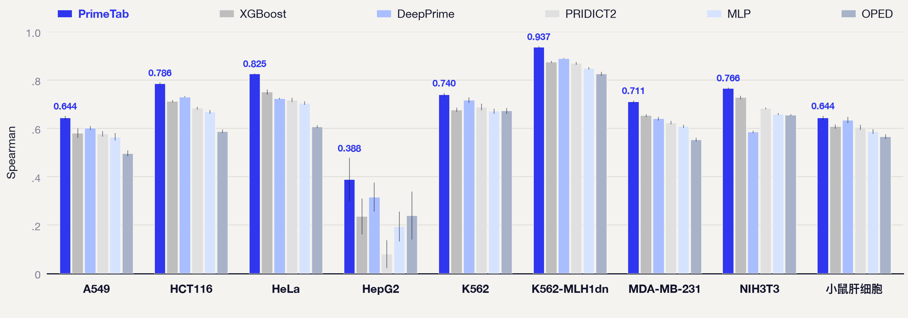

<p align="center">
  
</p>

# PrimeTab

**跨域泛化 + 上下文学习（ICL）驱动的可解释 pegRNA 自动设计框架**
*Cross-domain, in-context-learning driven interpretable pegRNA design with tabular foundation models.*

PrimeTab 把 Prime Editing 设计表示为**表格特征**，逐候选从历史实验记录中检索参考样本，
再由 **TabPFN（表格基础模型）** 以上下文学习方式预测编辑效率并排序。模型权重固定，新增
实验数据只进入上下文，实现**免训练**地适配新细胞 / 新数据集。

## 核心链路
```
目标编辑 (editseq)
  → PE2-NGG 候选生成（无模型）        primetab.generation
  → 73 项结构化特征 → 107 维输入      primetab.features
  → 逐候选参考样本检索               primetab.retrieval
  → TabPFN 上下文学习预测            primetab.backends / primetab.inference
  → 每个编辑请求内排序 → 候选清单     primetab.ranking
```

## 方法优势

**免训练接入新细胞。** TabPFN 权重固定，目标细胞的实测记录直接作为上下文进入推理。
接入一个新细胞系所需的是几十条带标签数据和一次推理，没有预训练、微调与超参数搜索环节。

**逐候选检索上下文。** 每条候选单独构造 1000 行参考集：目标细胞实测近邻，加上源池中
按特征分布与标签联合检索的样本。同一个模型改用随机抽取的 8023 行共享上下文时，
八细胞宏平均 Spearman 为 0.648；逐候选检索的 1000 行上下文为 0.757。

**跨细胞稳定。** 在九个目标条件（八个细胞系加小鼠肝细胞体内数据）上均取得最高 Spearman，
八细胞宏平均 0.757，第二名 0.698。标注最少的 HepG2（12 条）为 0.388，第二名 0.316。

**端到端可追溯。** 从 `editseq` 到候选清单一次跑完，输出候选表、特征表、排序结果、
NGS 引物与带校验值的 `manifest.json`。扰动单一特征即可得到预测响应，把排序结果关联到
具体的设计变量。



## 安装
```bash
pip install -e ".[tfm]"        # 含 TabPFN 推理
pip install -e ".[tfm,baselines,dev]"
```
特征工程依赖 ViennaRNA 与 Biopython；TabPFN 权重需按官方说明单独获取（不随仓库分发）。

## 快速开始
见 `examples/`。最小用法（仅生成候选）：
```bash
python -m primetab.generation batch --input examples/pe2_tasks.csv --output-dir out/
```
生成 + 排序（需参考上下文与 TabPFN 权重）见 `examples/` 与 `docs/method.md`。

## 模块
| 子包 | 作用 |
|---|---|
| `primetab.generation` | 无模型 PE2-NGG 候选生成（PBS 7–15、RTT 3–19） |
| `primetab.features` | 多数据集统一结构化特征（编辑几何、组成、热稳定性、二级结构） |
| `primetab.retrieval` | 逐候选参考检索 + 迁移学习上下文（TL-ANDI） |
| `primetab.backends` | TabPFN 等表格基础模型后端 |
| `primetab.ranking` | 一键式生成→排序流水线 |
| `primetab.benchmarks` | 跨细胞 / 跨域评测（Spearman、MAE） |
| `primetab.diagnostics` | 特征扰动可解释性 |

## 方法与复现
方法细节见 `docs/method.md`。数据来源（DeepPrime、PRIDICT2 公开补充表）与模型权重的获取见
`docs/` 与 `data/README.md`；原始大表与权重不随仓库分发。

## 许可证
MIT，见 `LICENSE`。第三方来源见 `THIRD_PARTY_NOTICES.md`；候选生成逻辑改编自
PRIDICT2（MIT），其版权与许可见 `primetab/generation/NOTICE`。

## 致谢
候选生成逻辑改编自 PRIDICT2；表格基础模型使用 Prior Labs 的 TabPFN；
特征计算使用 ViennaRNA 与 Biopython。
